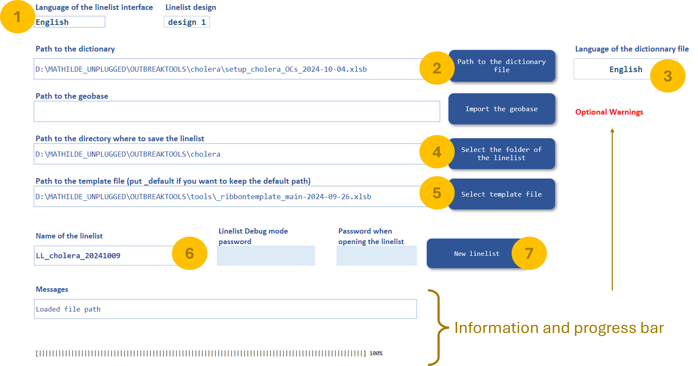
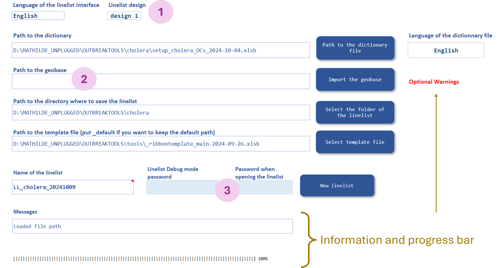
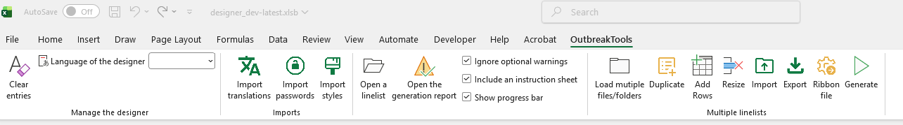
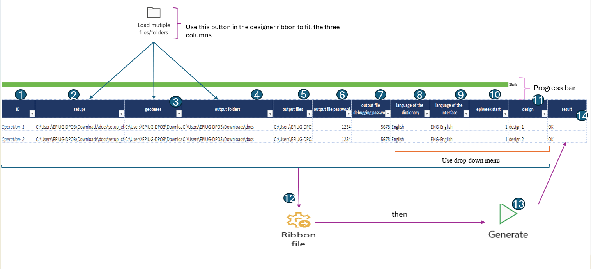

The **designer file** reads a **setup file**, compiles it and generates a **linelist file**.

{#fig-setup-ribbon fig-align="center"}

## Out-of-the-box compilation

0. Open a **designer file**

1. Choose the language of the interface of the linelist you want to build

2. Click on the blue button "Path to the dictionary file" to select the setup you want to use

3. Use the dropdown menu "Language of the dictionary file" to select one of the languages present in the setup file for the linelist content (the dropdown is on the right of the blue button)

4. Click on the button "Select the folder of the linelist" to select the folder where the linelist will be saved

5. Click on the button "Select template file" to provide the path to the ribbon template file (the file was in the [OutbreakTools zip archive that you downloaded](../getting_started/download.qmd#sec-obt-files)). This step is important to have the OutbreakTools option tab at the top of the file.

6. Provide the name of the linelist you want to generate

7. Click on the "New linelist" button and wait while compilation occurs. It could take several minutes.^[The more calculated columns and analyses there are, the longer it takes.]

{#fig-setup-ribbon fig-align="center"}

## Extra customisations

There are a couple of extra steps you can take.

{#fig-setup-ribbon fig-align="center"}

### Change style
You can select the other "Linelist design" using the dropdown menu (see the [ribbon](../reference/ribbons_designer.qmd#sec-setup-styles) to import your own style)

### Import a geobase

If you are compiling a linelist for a given country, you could generate the linelist with the geobase already imported. Click on the "Import de geobase" button to import a geobase in excel format (learn [how to get a geobase](../how_to/import_geobase#sec-geobase-download)) before compiling.

::: {.callout-note}
If no geobase is imported during compilation, the linelist user can [import one](../how_to/import_geobase#sec-geobase-import) at a later stage.
:::

### Add passwords

It is highly recommended to add passwords, both to prevent users from unwillingly break the file and to limit outside parties from opening the file. 

To do that, just fill the passwords in the little blue boxes before compiling.

## Advanced customisations

There are a couple more customisations available through the [OutbreakTools menu](../reference/ribbons_designer.qmd).

{fig-align="center"}

## Compilation advice

The linelist compilation relies on Excel VBA and can be a bit *finicky.* Here is some advice.

- [Run the checks](../reference/ribbons_setup.qmd#sec-check-setup) on the setup before attempting compilation to verify that everything is ready.

- Make sure there are no hidden columns or filters on the sheets of the **setup file**.

- Pause Onedrive or work in a non-synchronised folder (see [here](../getting_started/create_dic.qmd#sec-get-tools-ready) for more information)

- The compilation is sensitive to RAM limitations: if it fails it might be worth closing a couple of greedy applications and try again.^[For example, attempting compilation while sharing screen in a Teams call might ending up in failure on bad days.] 

- In general, it is always worth trying again: sometimes an action you did in another applications perturbed the process.

- If it fails, start with a new designer file, in case the previous one got corrupted when compilation failed.

- Excel VBA sometimes interacts with other Office applications. If all goes well, no problem. But in case of unexpected failures, try avoiding using Office applications while compiling.

::: {.callout-tip}
I prepare the **setup file**, the **designer file**, and then copy both of them and use the copies to compile. If a compilation fails, I delete both copies and start from fresh, just in case the failure to compile corrupted any of the file.
:::

## Multiple linelists generation steps

Within the designer, there is a sheet named *GenerateMultiple* that allows users to generate as many linelists as they need at once. To do this, use the tools in the Multiple Linelists section of the designer ribbon to populate the GenerateMultiple table. .See [mutliple linelist](../reference/ribbons_designer.qmd#sec-designer-multiple-linelists).

0. Open the designer file

1. The ID is generated automatically as soon as you upload the setups. Note that the ID can also be edited manually, so steps 1 and 2 can be performed in either order.

2. Select "Setups", then click Load Multiple Files/Folders in the designer ribbon to choose the setups you want to upload.

::: {.callout-note}

The load multiple files/folders step will be repeated until the  *geobases and output folders* cells  are filled.
:::

3. Select "geobases" to upload geobase files.

4. Select "output folders" to choose where the linelists will be saved.

5. Enter the names of the linelists you want to generate in the "Output files".

6. Enter passwords to be used while opening the linelists in the "output file password"  

7. Enter debugging passwords in the "output file debugging password" column. This is key because it prevents the users from accidentally or deliberately breaking the linelist files.

8. Use the drop-down menu "Language of the dictionary" to select a language present in the setup files for the linelist content

9. Use the drop-down menu "Language of the interface" to select the language in which the linelist’s labels, headings, and other text will be displayed.

10. Define  the epiweek using the drop-down menu in the "epiweekstart"

11. Use the drop-down menu in "design" to choose how the generated linelists will look. 

12. Click on the "ribbon file" in the designer ribbon to attach a template file.

13. Click the "Generate" button to start the generation process.

14.  Once the generation is complete, a report of each generation will appear in the *Result* column.

{#fig-setup-ribbon fig-align="center"}

