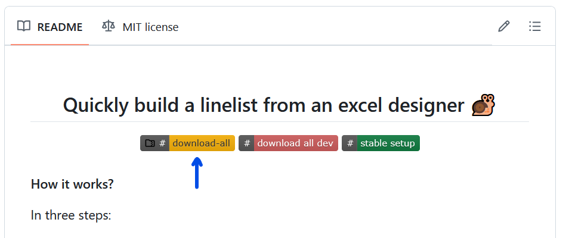

## Download the OutbreakTools archive 📦 {#sec-download}

Go to the [OutbreakTools github repo](https://github.com/epicentre-msf/outbreak-tools), scroll down to the README and click on the yellow button to donwload `.zip` archive that contains the file you need.

Save the archive locally on your computer and unzip it.

## Install the OubreakTools files {#sec-obt-files}

The solution is based on VBA scripts in Excel files, so there is nothing to install.

You should however [authorise VBA macros in Excel](https://support.microsoft.com/en-us/office/enable-or-disable-macros-in-microsoft-365-files-12b036fd-d140-4e74-b45e-16fed1a7e5c6) so that the files work as expected (or at all, in fact).

The archive contains four files, each carrying the version number:

- `setup_main-<version>.xlsm`: an empty **setup file**
- `designer_main-<version>.xlsm`: the **designer file** that is used to compile the setup
- `msetup_main-<version>.xlsm`: the **master setup**, which holds the setups of several diseases
- `_ribbontemplate_main-<version>.xlsm`: a template file containing information used during compilation

:::{.callout-note}
The Excel files are in the `.xlsm` format, the Excel workbook format that carries VBA macros. Earlier versions shipped `.xlsb` files. A setup saved as `.xlsb` still loads in the new designer.
:::

## Update to a new version of OutbreakTools

The OutbreakTools solution is in active development, so there are regular updates to the files, to add new functionalities or correct bugs. To upgrade, just [dowload the tools](https://github.com/epicentre-msf/outbreak-tools) again and use the new **setup** and **designer**. If you already have a working setup for a linelist, it is possible to [migrate](../how_to/migrate_setup.qmd) its content to a new empty **setup file**.