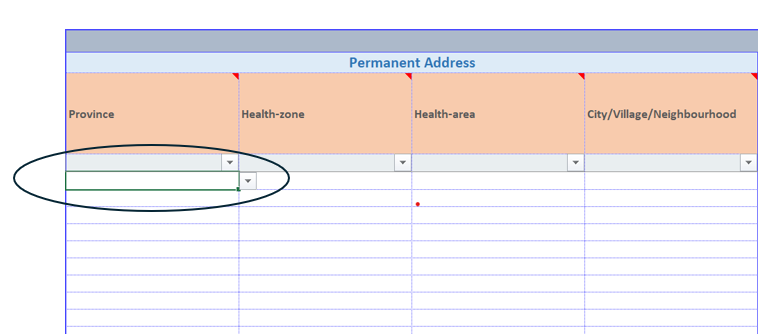
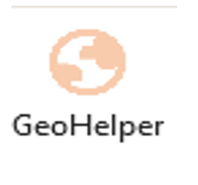
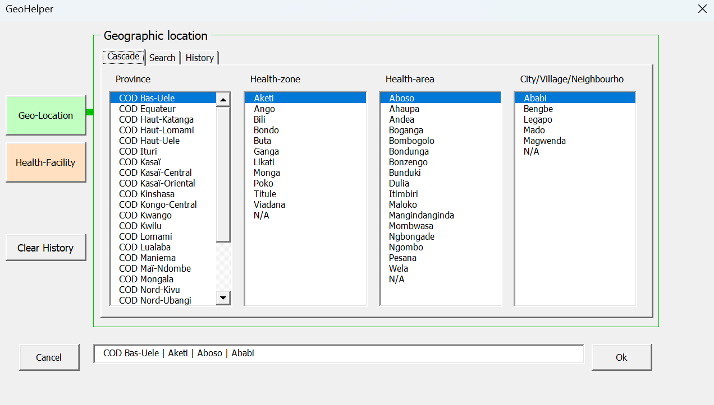
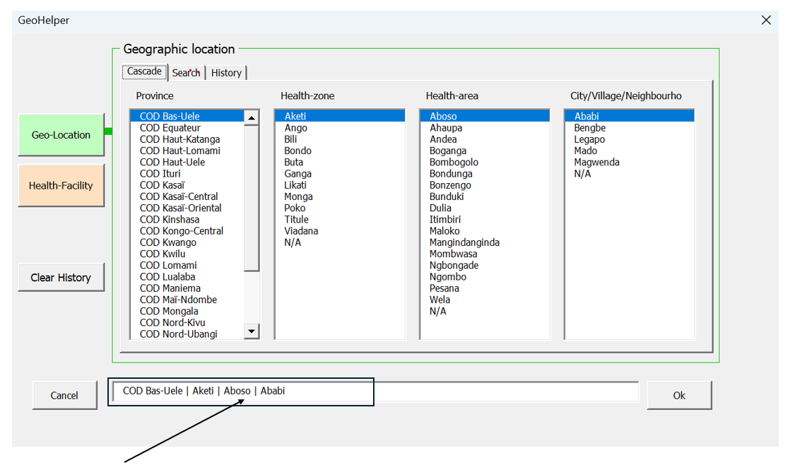
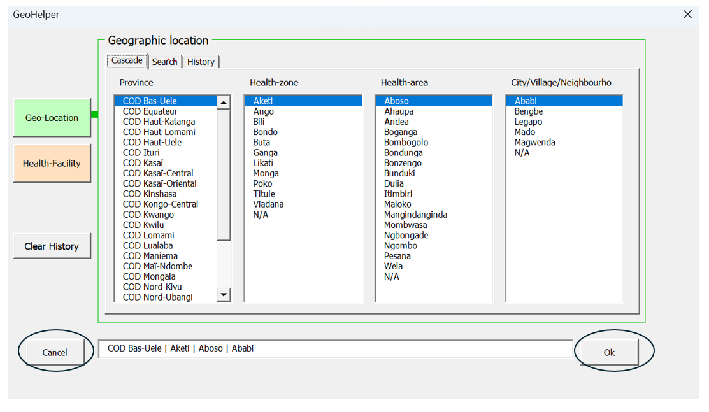

The Geohelper icon in the linelist ribbon helps users enter geographic data into the patient data sheet. Instead of selecting locations manually from the Admin1 to Admin4 drop-down menus, users can select all the administrative levels in one go, and the information is filled in automatically.

The Geohelper is also useful when location information is incomplete. If a user only has the Admin1 or the Admin4 of a patient, for example, the Geohelper provides the missing levels. To do this, use the Search tab in the Geohelper window.

Before you start, make sure the geobase has been imported into the linelist. Then follow the steps below.

1. Place the cursor in the first column of the geographic variables.

{fig-align="center"}

2. Click the GeoHelper icon  in the linelist ribbon
	
{fig-align="center"}
 
 {fig-align="center"}

3.In the Cascade tab, select a location  in each list, from left to right. In this example below, the levels are Province, Health-zone, Health-area and City/Village/Neighbourhood. Each list is filled according to what you selected in the one before it.

{fig-align="center"}
4. Check your selection in the bar at the bottom of the window.

{fig-align="center"}

5. Click Ok to confirm, or Cancel to close the window without entering anything.

{fig-align="center"}

::: {.callout-note}

The headers of admin  levels vary by country, depending on how each country names its administrative divisions.

:::

