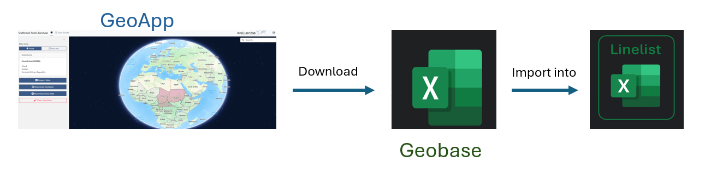
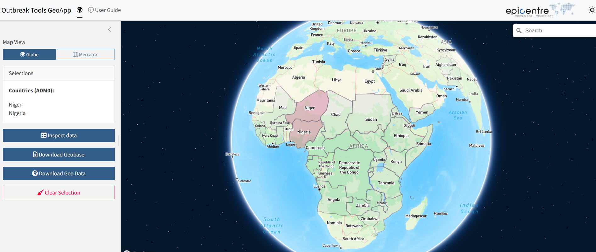

## Download a geobase {#sec-geobase-download}

{fig-align="center"}

1. In your internet browser, go to the [Geoapp](https://reports.msf.net/secure/app/outbreak-tools-geoapp). 

2. Use your account to connect. If you do not have one already, create one [here]( https://reports.msf.net/signup/) first^[You will need an MSF mail address] then connect to the GeoApp.

3. Select one or more countries on the Globe or Mercator map. The countries you select appear on the left, under *Selections*. You can also use the "Search" box at the top right of the GeoApp to find a country by name.

4. Selected regions turn red. Once one region has been selected, buttons to inspect and download the data will appear below the selected countries.

{fig-align="center"}

5. Click on the "Download Geobase" button to download the data for the selected regions in an excel format that can be directly imported into an OutbreakTools Linelist.

6. Click "Clear Selection" to remove all selected countries at once. Alternatively, click each highlighted country on the map  to deselect them one by one. The Selections panel updates as you go, so you can confirm which countries are still selected.

::: {.callout-note}
The geospatial administrative boundary data used to build the geobase can also be downloaded in the format of your choice, compatible with GIS software (e.g. QGIS, ArcGIS) and the R statistical software by clicking on the "Download geo Data" button.
:::

## Import a geobase in a linelist {#sec-geobase-import}

Once you have downloaded a geobase from the [Geoapp](https://reports.msf.net/secure/app/outbreak-tools-geoapp), you can import it in an OBT linelist.

1. Open the linelist
2. Go to the [OutbreakTools Menu](../reference/ribbons_linelist.qmd)
3. Click on the ["Import geobase" button](../reference/ribbons_linelist.qmd#sec-import-geobase)
