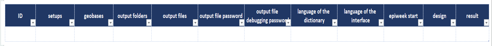

The designer workbook contains a Generate multiple sheet, which lets users set up and generate several linelists at once.
The sheet is built around a table where each row corresponds to one line list, and each column holds a piece of information needed to generate it.

{fig-align="center"}

To populate the table, the **designer ribbon** contains the buttons that aid in that. See [mutliple linelist](../reference/ribbons_designer.qmd#sec-designer-multiple-linelists)

