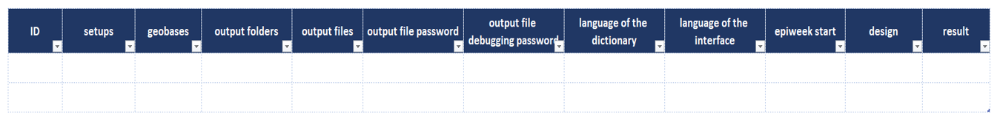

The designer workbook contains a generate multiple sheet, which lets users set up and generate several linelists at once.
The sheet is built around a table where each row corresponds to one linelist, and each column holds a piece of information needed to generate it.

{fig-align="center"}

To populate the table, use the buttons in the **designer ribbon** To understand the purpose of each button, see [mutliple linelist](../reference/ribbons_designer.qmd#sec-designer-multiple-linelists).

The columns of the table are explained below.

**ID:** This column displays the ID of each linelist. You can enter your own ID, or leave the field empty and one will be generated automatically once you upload the setup.

**Setups:** This column lists the setups uploaded with the **Load multiple files/folders** button. A setup can be an `.xlsx` or `.xlsb` file. To load several setups at once, save them first in the same folder, then select them together.

**Geobases:** This column holds the geobase files. To load several geobases at once, save them in the same folder, hold Ctrl on your keyboard and select the files. 

::: {.callout-important}
Geobases are not matched to the setups already loaded. They are filled in the order in which they are saved in the folder, so check that each geobase sits on the same line as its setup.
:::

**Output folders:** Place the cursor in a cell under this column and click **Load multiple files/folders**. A pop-up will appear where you choose the path in which the linelist will be saved. Also note that paths are loaded one at a time.

**Output files:** This is a free text field where you enter the name of each linelist to be generated.

**Output file password:** This is a free text field where you enter the passwords for each linelist to be generated. Adding a password prevents outside parties from opening the file. Keep a record of the passwords you enter: if you close the Designer without saving, they are lost and the generation process will have to be repeated.

**Output file debugging password:** This is a free text field where you enter the password for the linelist’s debug mode. It helps prevent users from accidentally breaking the file.

**Language of the dictionary:** Select the language of the dictionary from the drop-down menu. The built-in languages are English, Français, Arabic and Portuguese.

**Language of the interface:** Select the language in which the interface will appear from the drop-down menu. The built-in languages are English, Français, Arabic and Portuguese.

**Epiweek start:**Use the drop-down menu in this column to define the epiweek start.

**Design:** The designer has a sheet called *formatter* with the columns design 1, design 2 and user defined. They show the available formats and how the linelist will look. Use the drop-down menu in this column to choose the look of the generated linelist.

**Result:** This column reports the outcome of each generation.

